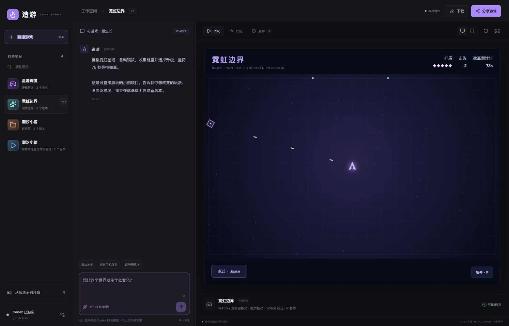

# 造游 · Game Forge

对话创作游戏的本机工作台：描述玩法，生成可玩的浏览器游戏，在同一项目里持续修改、查看代码、恢复版本，再分享独立试玩链接。

**[打开本机创作工作台](http://127.0.0.1:4317)** · **[公开示例与分享播放器](https://yiheng-guo.github.io/game-forge/)**



## 能做什么

- **真实对话生成**：通过本机已登录的 Codex 生成完整 HTML / Canvas 游戏；修改时携带所选版本，而非重新选择固定模板。
- **即时试玩**：生成完成后进入隔离 iframe，支持电脑、手机尺寸和全屏预览。
- **版本迭代**：每次成功生成或代码保存形成独立版本，可试玩历史版本、恢复旧版、从旧版分支继续修改。失败或取消保留已有版本。
- **代码编辑**：查看与编辑完整 HTML，保存前检查语法和初始运行，不覆盖历史版本。
- **运行错误修复**：捕获试玩区错误，可发送给 Codex；生成流程在首次初始运行失败时最多尝试一次修复。
- **分享和下载**：下载自包含 HTML，或复制包含压缩游戏代码的独立链接。朋友不需要启动你的本机服务。
- **独立项目**：创建、搜索、重命名和移除项目；移除的内容保留在本机回收目录。

## 启动

需要 Node.js 22.12+、已登录的 Codex CLI，以及用于初始运行检查的 Chrome 或 Playwright Chromium。

```bash
git clone https://github.com/Yiheng-guo/game-forge.git
cd game-forge
npm ci
npm run build
npm start
```

打开 `http://127.0.0.1:4317`。macOS 也可以双击仓库中的 `打开造游.command`。首次使用 Codex 时先执行 `codex login`。

程序优先识别 macOS Codex 内置 CLI，否则使用 PATH 中的 `codex`。可以用 `CODEX_BIN` 指定位置、`CODEX_MODEL` 指定模型、`CHROME_PATH` 指定浏览器、`PORT` 指定本机端口、`FORGE_DATA_DIR` 指定数据目录。默认读取本机配置中的模型名称，通过 Codex 自己的登录机制调用，不读取或导出登录凭据。

没有 Chrome 时：

```bash
npx playwright install chromium
```

## 创作示例

> 做一个海岛咖啡馆经营游戏。顾客会排队和失去耐心，制作咖啡交付赚钱，升级设备与座位，连续三天达到目标获胜。画面有海岸、桌椅和顾客，手机也能玩。

生成后继续说：

> 保留现有玩法，增加可购买的外卖窗口，价格 30 金币，每天结束额外获得 12 金币。保留咖啡机、座位、三天目标、暂停和重开。

需求越大，生成越久。界面显示真实任务状态和等待时间，可取消；不会用预设定时动画伪装生成进度。每次调用使用当前 Codex 账号的可用额度，不能据此推断免费、无限或具体账单。

## 本机与公网的区别

本机工作台运行真实生成服务并保存项目；公网静态页面提供示例、代码查看和分享播放器。公网页面不提供无人值守的模型调用，不把本机 Codex 服务暴露给外部访问。

分享链接只包含选中游戏的代码、标题、目标和操作说明，不包含聊天记录。链接拥有者可以查看、转发或修改游戏；不适合放入密钥或私密数据。链接长度超过限制时使用 HTML 下载。当前未提供在线多人协作、游戏服务器、Unity/Unreal 编辑器或大型多资源构建。

## 数据和隔离

项目、对话和版本保存在 `.data/projects.json`，写入采用顺序队列和原子替换，并保留上一份 `.bak`。删除项目保留在 `.data/trash/`；这些目录不会进入 Git。不要让多个服务进程共享同一个数据目录。

服务只监听回环地址，API 采用同源检查和进程随机请求令牌。游戏代码在不含 `allow-same-origin` 的 iframe 中运行，CSP 限制网络、框架、表单和外部资源。运行检查使用独立的临时浏览器上下文，生成进程使用只读权限并禁用 shell 工具。不要将本机服务直接反向代理到公网；生产化部署需要独立身份、配额与任务隔离。

## 示例项目与技能来源

霓虹边界是动作生存示例；潮汐小馆由真实 Codex 创作链路生成；星港调度是已有解谜项目的单文件移植。示例可以直接试玩，不意味着所有生成请求都能一次成功。

生成器实际读取 `skills/` 中 7 个 [PM Game Skills](https://github.com/Yiheng-guo/pm-game-skills) 技能正文：产品定义、引擎选择、代码质量、试玩发布、浏览器游戏、游戏反馈、界面设计。技能文件遵循其 Apache 2.0 许可证，见 [skills/NOTICE](skills/NOTICE)。

## 开发与测试

```bash
npm test
# 先启动 npm start，再在另一个终端执行：
npm run test:browser
npm run test:examples
```

自动运行检查仅覆盖初始加载，不等于完整通关、无缺陷或真人觉得好玩。浏览器测试覆盖项目操作、代码保存、版本恢复、分享、隔离和窄屏操作；真实模型调用单独执行，不在 CI 中消耗账户额度。

[产品说明](docs/PRODUCT.md) · [架构与边界](docs/ARCHITECTURE.md) · [许可证](LICENSE)
